# TaskBloom - Task Management App

TaskBloom is a Flutter task management app that helps you plan your day. You can create tasks with categories, due dates, subtasks and repeat schedules, track daily progress, search and filter tasks, and get reminder notifications.

**Developed by:** Rida Riaz
**Registration No:** FA24-BCS-197
**Course:** Mobile and App Development

## Links

- **GitHub Repository:** https://github.com/talef3053-del/task-management-app
- **Demo Video:** [Watch the demo on Google Drive](https://drive.google.com/file/d/1_y-z8-GWtUblOgLfh3_wX4BoJydMtW1U/view?usp=sharing)

---

## Features

- Add new tasks with title, description, category, date and time
- Categories: Personal, Study, Work, Health, Shopping, Other
- Subtasks with a progress bar for each task
- Repeat tasks daily or weekly, with selectable days (Mon to Sun)
- Tabs to organize tasks: Today, Upcoming, Completed, Repeated
- Overdue tasks are highlighted in red
- Daily progress summary with a greeting (for example "0/1" tasks done)
- Search tasks by keyword
- Filter tasks: All tasks, Overdue only, Repeating only
- Reminder notifications at the task time
- Multiple color themes (blue and green)

---

## Screenshots

### Home Screen

| Today (Overdue Task) | Upcoming Tasks |
|---|---|
| 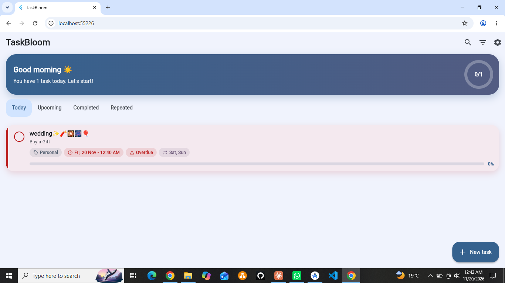 | 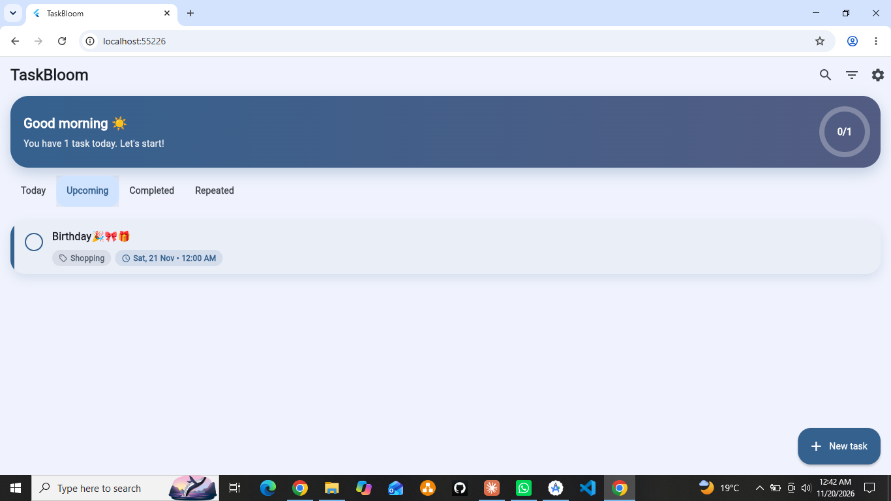 |

| Green Theme | Notification |
|---|---|
| 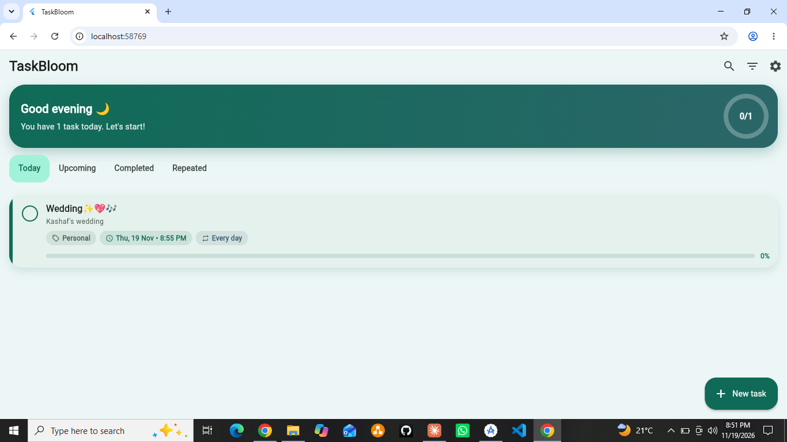 | 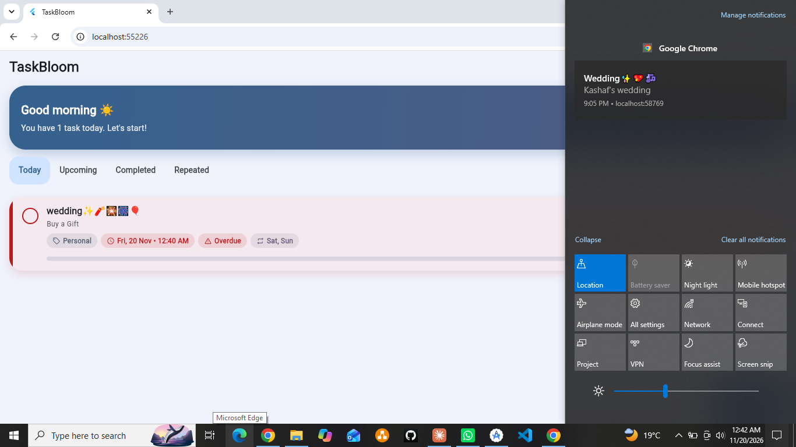 |

### Search and Filter

| Search and Repeated Tab | Filter Menu |
|---|---|
| 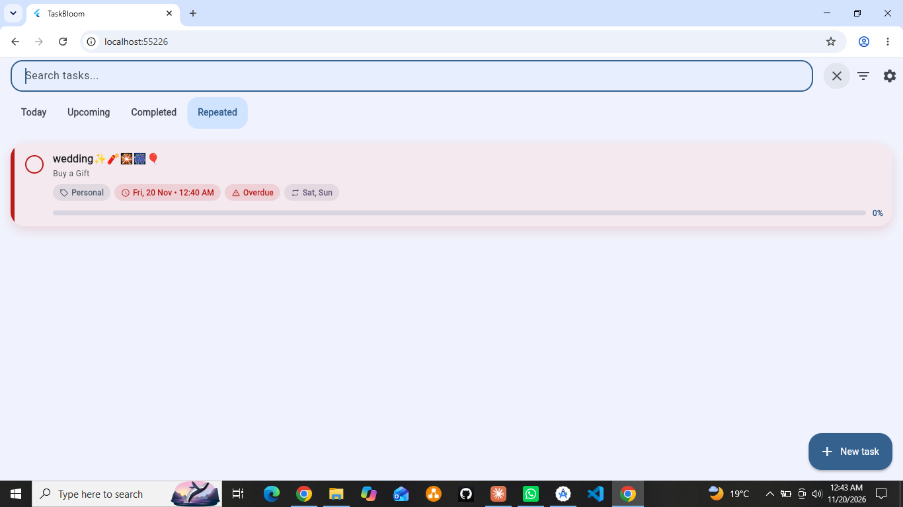 | 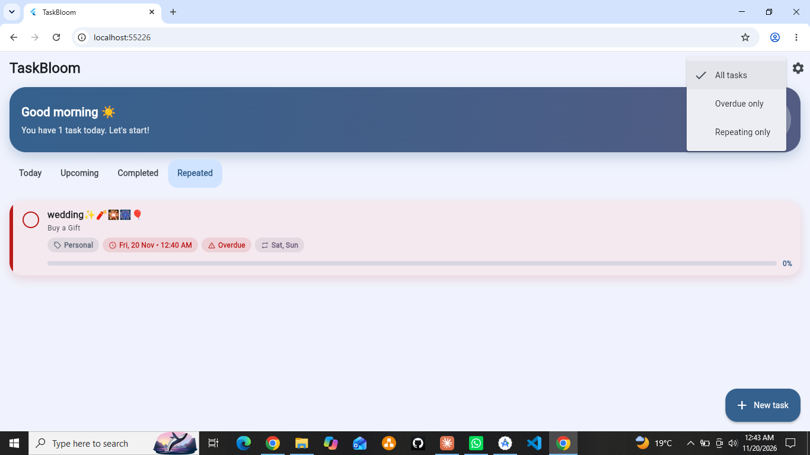 |

### Creating a Task

| New Task Form | Category List |
|---|---|
| 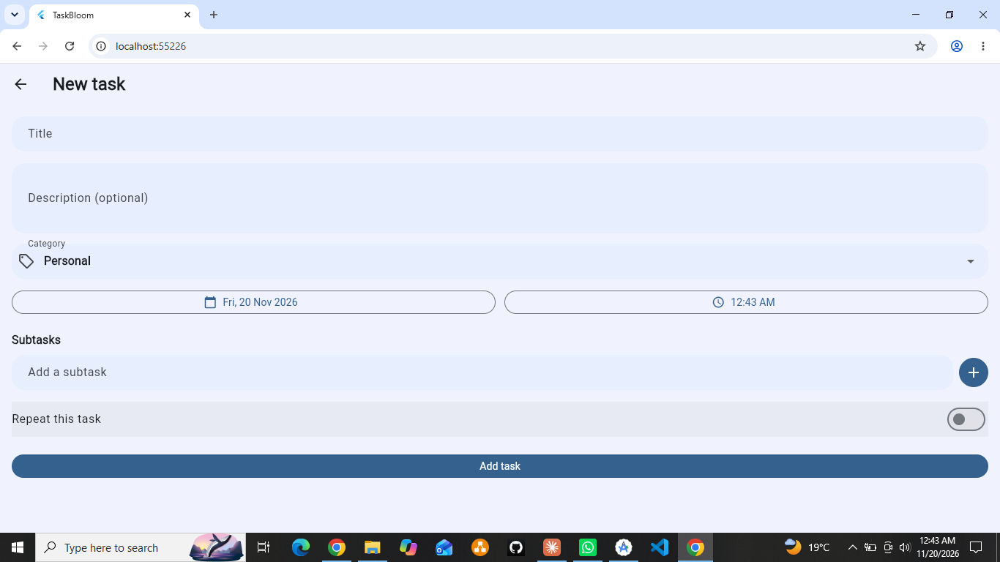 | 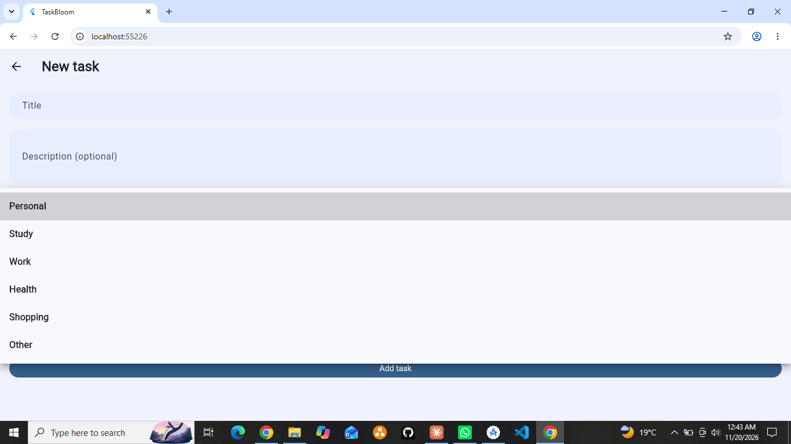 |

| Date Picker | Time Picker |
|---|---|
| 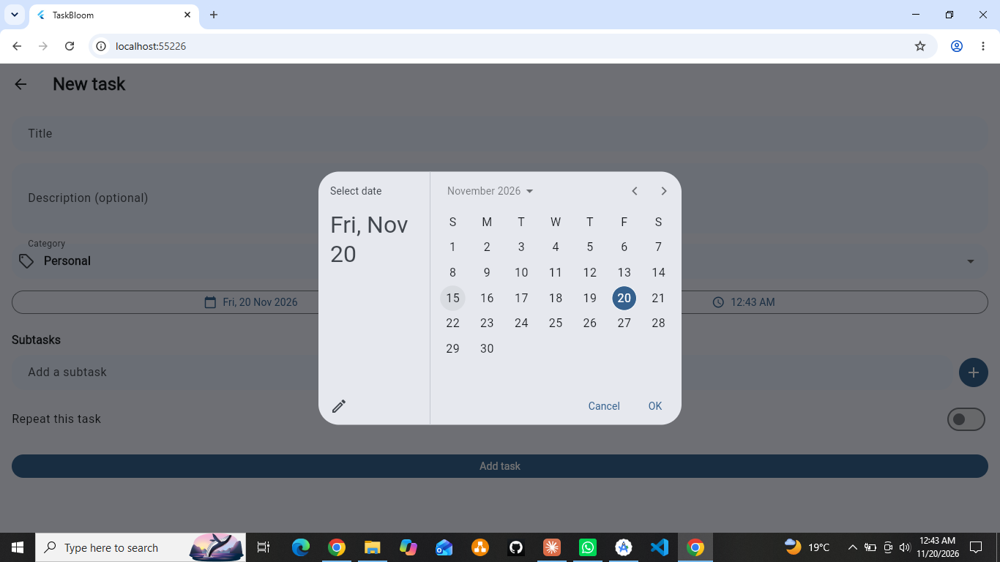 | 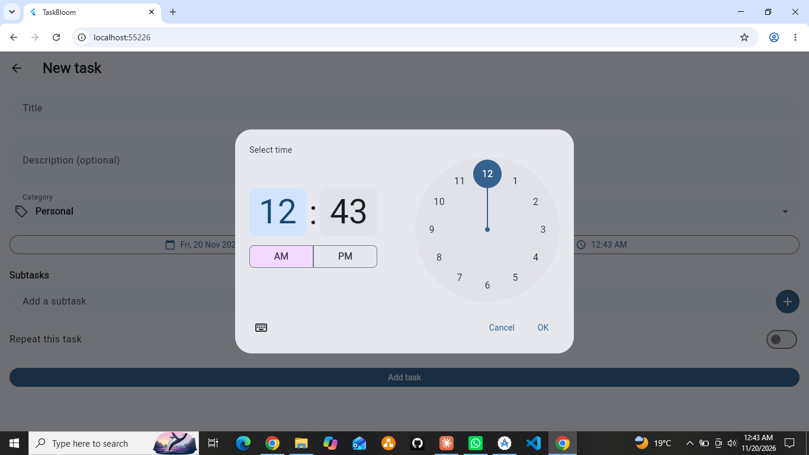 |

### Repeat Task

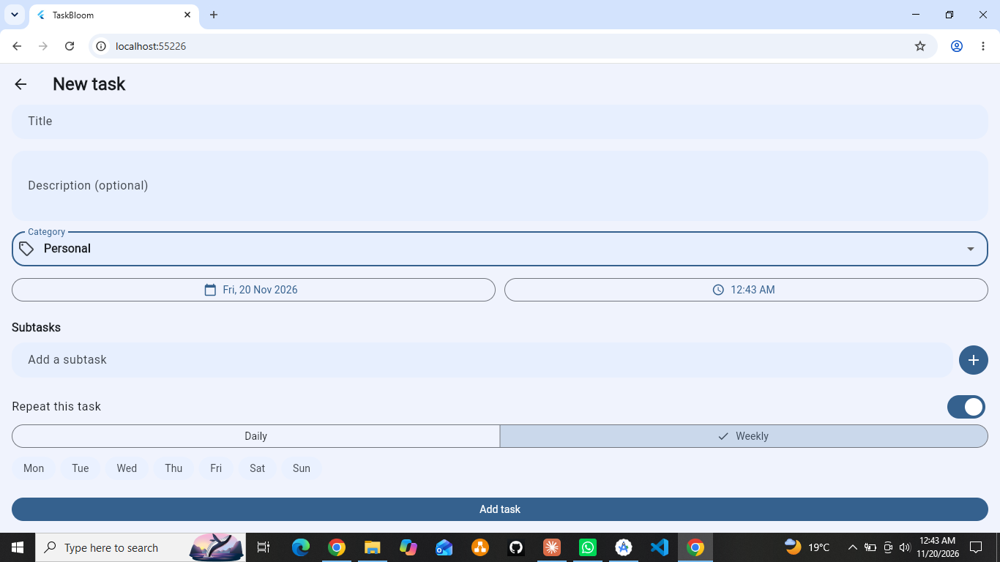

---

## Demo Video

[Click here to watch the demo video](https://drive.google.com/file/d/1_y-z8-GWtUblOgLfh3_wX4BoJydMtW1U/view?usp=sharing)

---

## Technologies Used

- Flutter and Dart
- Local notifications

---

## How to Run the Project

1. Install [Flutter](https://docs.flutter.dev/get-started/install).
2. Clone the repository:
   ```bash
   git clone https://github.com/talef3053-del/task-management-app.git
   ```
3. Open the project folder:
   ```bash
   cd task-management-app
   ```
4. Install the dependencies:
   ```bash
   flutter pub get
   ```
5. Run the app:
   ```bash
   flutter run
   ```
